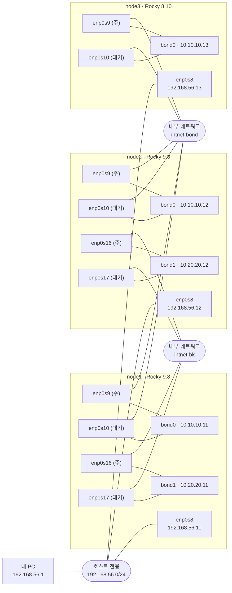

# 2 · OS(Rocky Linux 9.x & 8.10) 네트워크 이중화(Bonding) 구성 테스트

> 명령어와 출력까지 담은 상세 기록은 [DETAILS.md](./DETAILS.md)에 있고, 개념 정리는 [CONCEPTS.md](./CONCEPTS.md)에 있습니다.

## 한 줄 요약
node1을 복제해 node2를 만들고, 두 서버에 **active-backup bond를 2개(bond0, bond1)** 구성했습니다. 랜선을 하나 끊어도 ping 손실이 1~2개뿐인 것을 확인했고, 실제로 겪은 장애 3개와 일부러 낸 장애 3개를 원인부터 복구까지 기록했습니다. Rocky 8.10(node3)에서도 같은 명령으로 bond0를 만들어 9.8과 똑같이 동작하는 것을 확인했습니다.

## 구성도

- **bond0**와 **bond1**은 서로 다른 네트워크라 한쪽 장애가 다른 쪽에 영향을 주지 않습니다.
- 평소에는 **(주)** 포트만 쓰고, 끊기면 **(대기)** 포트로 넘어갑니다.
- SSH는 bond와 별도인 호스트 전용 네트워크(enp0s8)로 접속해, bond 실습 중에도 끊기지 않습니다.

---

## 1. 과제 요구사항과 결과

| 요구사항 | 결과 |
| --- | --- |
| 네트워크 bonding 구성 종류 확인 | ✅ 모드 0~6 비교, active-backup 선택 이유 정리 ([CONCEPTS.md](./CONCEPTS.md)) |
| bonding 1개 구성 (Active-Backup) | ✅ bond0, 페일오버 손실 **1/210**, 페일백 손실 **0** |
| bonding 2개 구성 (Active-Backup) | ✅ bond0 + bond1, 한쪽 장애가 다른 쪽에 영향 없음 (bond1 2/40, bond0 0/40) |
| bonding 트러블슈팅 | ✅ 실제 장애 3건 + 일부러 낸 장애 3건(기본 경로 중복, 포트 이탈, 링크 감시 꺼짐) |
| Rocky 9.x & 8.10 모두 | ✅ 8.10(node3) bond0 구성, 장애 전환 손실 **1/101**, 설정은 `ifcfg-bond0`에 저장 |
| 재부팅 후 유지 | ✅ node1 · node2 · node3 모두 |

---

## 2. 실습 환경

| 구분 | node1 | node2 | node3 |
| --- | --- | --- | --- |
| OS / 커널 | Rocky 9.8 / 5.14 | Rocky 9.8 / 5.14 (node1 복제) | Rocky 8.10 / 4.18 |
| 관리망 (SSH) | 192.168.56.11 | 192.168.56.12 | 192.168.56.13 |
| bond0 = enp0s9 + enp0s10 | 10.10.10.11/24 | 10.10.10.12/24 | 10.10.10.13/24 |
| bond1 = enp0s16 + enp0s17 | 10.20.20.11/24 | 10.20.20.12/24 | 없음 |

- node1 · node2에는 NIC 4개, node3에는 NIC 2개를 추가하고, VirtualBox **내부 네트워크** 2개(intnet-bond, intnet-bk)에 2개씩 연결했습니다.
- 랜선 뽑기는 내 PC에서 `VBoxManage controlvm <VM> setlinkstateN off/on` 명령으로 했습니다.

---

## 3. 수행한 작업 (순서대로)

| # | 작업 | 확인 |
| --- | --- | --- |
| 1 | bonding 모드와 용어 정리 | CONCEPTS.md, PDF |
| 2 | node1 완전 복제 → node2. MAC, machine-id, SSH 키, hostname, IP 새로 생성 | 두 서버의 MAC, SSH 지문이 서로 다름 |
| 3 | 두 서버에 NIC 4개 추가 (내부 네트워크, 무작위 모드 allow-all) | `ip -br link`에 enp0s9, 10, 16, 17 |
| 4 | bond0 구성 (`mode=active-backup, miimon=100, primary, fail_over_mac=active`) | `/proc/net/bonding/bond0` |
| 5 | bond0 장애 전환: 어댑터 3 끊기 → 연결 | 손실 1/210, 다시 primary로 복귀 |
| 6 | bond1 구성 (게이트웨이 없이) | 기본 경로 1개 유지 |
| 7 | 독립성 테스트: bond1만 끊기 | bond1 2/40, bond0 0/40 |
| 8 | 장애 재현 7-A (기본 경로 중복), 7-B (포트 이탈), 7-C (링크 감시 꺼짐) | 재현 → 원인 확인 → 복구 |
| 9 | node3(8.10)에 NIC 2개 추가, 자동 프로파일 삭제, bond0 구성 | `ifcfg-bond0`의 `BONDING_OPTS` |
| 10 | node3 장애 전환, 세 서버 재부팅 후 유지 확인 | 손실 1/101, 재부팅 후 설정 그대로 |

단계마다 스냅샷을 남겼습니다: `과제2-시작전` → `과제2-bond0완료` → `과제2-bond1완료` → `과제2-node3-NIC추가전`(node3) → `과제2완료`(세 대 모두, 전원 끈 상태)

---

## 4. 겪은 장애와 해결

| # | 장애 | 원인 | 해결 |
| --- | --- | --- | --- |
| 1 | 새 NIC에 `Wired connection` 프로파일이 자동으로 붙음 | NetworkManager가 설정 없는 NIC에 DHCP 프로파일 자동 생성 | 자동 프로파일 삭제 후 bond 포트 연결 |
| 2 | bond0 ping 100% 실패 (ARP FAILED) | `fail_over_mac=none`이라 bond MAC이 대기 포트의 MAC이 됨 → VirtualBox가 대기 포트로 전달 → 버려짐 | `fail_over_mac=active` (tcpdump로 대기 포트 수신 확인) |
| 3 | 설정 직후 bond0 `connecting`, fe80만 보임 | 활성화가 끝나기 전에 확인 | 10초 뒤 재확인하니 정상 |
| 7‑A | 외부 통신이 엉뚱한 곳으로 감 | 내부망 bond1에 게이트웨이를 넣어 default 경로 2개 | 게이트웨이 제거, `ip route get`으로 확인 |
| 7‑B | 평소엔 정상인데 포트 하나 끊자 **46/67 손실** | 포트 하나가 이미 빠져 있었음 (이중화 상실) | 포트 복구, 점검에 **포트 개수** 확인 추가 |
| 7‑C | 대기 포트가 멀쩡한데도 넘어가지 않아 **26/50 손실**. bond 상태는 계속 `up` | `miimon=0`으로 링크 감시가 꺼져 끊김을 모름 (로그 경고도 없음) | `miimon=100` 복구, 점검에 **감시 간격** 확인 추가 |

---

## 5. 배운 핵심 개념

| 개념 | 한 줄 설명 |
| --- | --- |
| active-backup | 포트 하나만 쓰고, 죽으면 대기 포트로 넘김. 스위치 설정이 필요 없음 |
| miimon | 포트 링크를 확인하는 간격(ms). 0이면 감시 안 함 |
| primary | 살아 있으면 우선 쓰는 포트. 복구되면 다시 돌아옴 |
| fail_over_mac=active | bond MAC이 활성 포트를 따라감. 가상화 환경에서 중요 |
| 기본 경로는 하나 | 내부망 bond에는 게이트웨이를 넣지 않음 |
| `/proc/net/bonding/bondN` | 모드, 활성 포트, 포트 개수, 감시 간격, 장애 횟수를 보는 곳 |
| `/sys/class/net/<포트>/carrier` | 커널이 본 실제 링크 상태(1/0). bond가 보는 상태와 다르면 감시 문제 |

---

## 6. 한 문단 설명
랜카드 두 개를 묶은 bond를 만들고, 한쪽 링크를 끊어도 대기 포트로 넘어가 통신이 이어지는 것을 확인했습니다. 가상화 환경에서는 `fail_over_mac` 설정이 없으면 패킷이 대기 포트로 들어가 버려지는 문제가 있었고, tcpdump로 들어오는 포트를 확인해 원인을 찾았습니다. 또 포트가 하나 빠져도 겉으로는 정상으로 보인다는 점을 직접 재현해, ping이 아니라 `/proc/net/bonding`의 포트 개수로 이중화를 점검해야 한다는 것을 배웠습니다. 링크 감시(miimon)를 끄면 랜선이 빠져도 bond는 계속 정상으로 보이고 로그도 남지 않아서, 감시 간격과 실제 링크 상태(carrier)를 함께 봐야 한다는 것도 확인했습니다. Rocky 8.10에서도 nmcli 명령은 같고 설정만 `ifcfg-bond0`의 `BONDING_OPTS` 한 줄로 저장되어, 고객사 8.x 서버는 이 파일을 보면 된다는 것을 정리했습니다.

---

## 7. 남은 항목
없음. 과제 2 완료 (스냅샷 `과제2완료`).
